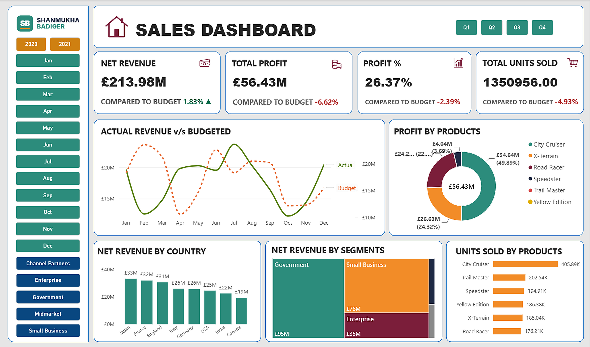

# 📊 Actual vs Budget Financial Analysis — Power BI Dashboard

An interactive Power BI dashboard that compares **actual sales performance against budget** across products, countries, customer segments and time (2020–2021).



---

## 🎯 Objective

Help management answer one question at a glance: **"Are we hitting our budget — and where are we falling short?"**
Every KPI card shows the actual figure alongside its variance from budget, and the slicers let you drill into any year, quarter, month or customer segment.

## 📌 Key KPIs

| KPI | Actual | vs Budget |
|---|---|---|
| Net Revenue | £213.98M | **+1.83%** ▲ |
| Total Profit | £56.43M | **−6.62%** ▼ |
| Profit % | 26.37% | **−2.39%** ▼ |
| Units Sold | 1.35M | **−4.93%** ▼ |

## 💡 Key Insights

- **Revenue beat budget, but profit missed it.** Net revenue came in 1.83% above budget while profit fell 6.62% short, which points to rising costs or heavier discounting eating into margin.
- **Fewer units, more revenue.** Units sold were 4.93% below budget, yet revenue was above it, so growth came from price/mix rather than volume.
- **City Cruiser is the star product.** It leads units sold (405.89K, about double the next product) and is the largest contributor to profit.
- **Government is the biggest segment** (£95M net revenue), followed by Small Business (£76M) and Enterprise (£35M).
- **Japan, France and England are the top markets** (£31M–£33M each); Canada is the smallest (£19M).
- **Revenue is volatile month to month.** Actual revenue swings well above and below budget (e.g. strong in July, weak in February and October), suggesting seasonality that the budget doesn't capture.

## 🛠️ Features

- **KPI cards** with actual vs budget variance and conditional colouring (green = ahead, red = behind)
- **Actual vs Budget trend line** by month
- **Profit by product** (donut chart)
- **Net revenue by country** (column chart) and **by segment** (treemap)
- **Units sold by product** (bar chart)
- **Slicers** for year, quarter, month and customer segment

## 🧰 Tools & Skills

- **Power BI Desktop**
- **Power Query** — data cleaning and transformation
- **Data modelling** — fact table (`Data`) related to a budget table (`tbl_Budget`)
- **DAX** — measures for actuals, budget and variance % kept in a dedicated `METRIC TABLE`
- **Dashboard design** — custom colour theme, icons and layout

## 📂 Repository Structure

```
   ├── Actual_vs_Budget_Financial_Analysis.pbix   # Power BI report
   ├── dashboard.png                              # Dashboard screenshot
   ├── logo.png
   └── README.md
```

## 📁 Dataset

Practice dataset based on Microsoft's Power BI [Financial Sample](https://learn.microsoft.com/en-us/power-bi/create-reports/sample-financial-download) (modified: product names, countries and years changed), with a budget table added for actual-vs-budget analysis. All figures are fictional.

## ▶️ How to Open

1. Download `Actual_vs_Budget_Financial_Analysis.pbix` from this repository.
2. Open it in the latest version of **[Power BI Desktop](https://www.microsoft.com/power-bi/desktop)** (free).
3. Use the slicers on the left and the quarter buttons at the top to explore.

---

👤 **Shanmukha Badiger**
